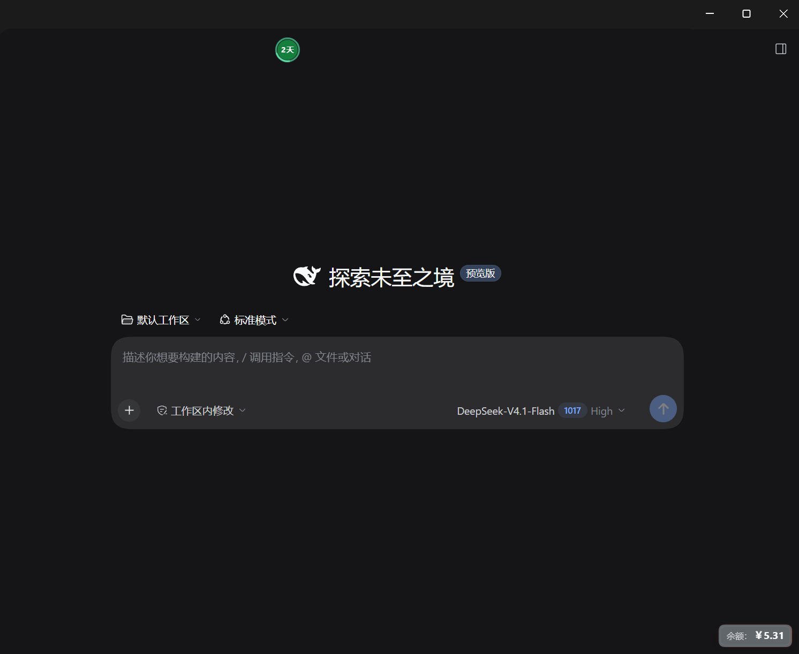
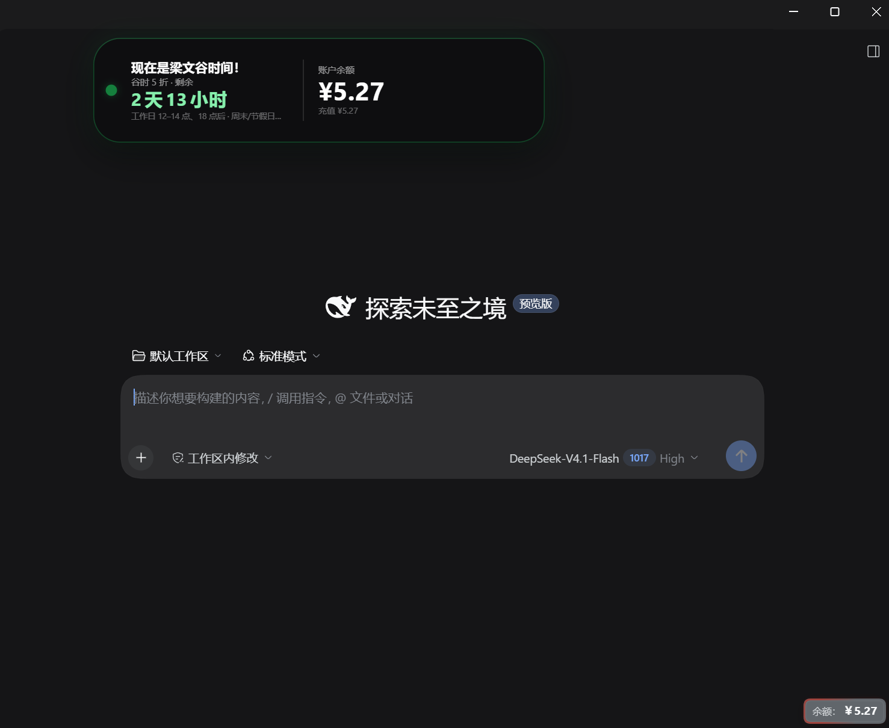
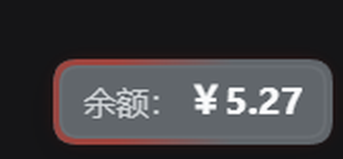

# dsh-peak-valley-reminder

给 DeepSeek Harness（DSH）用的 Web 客户端插件：在窗口顶部居中显示一个「灵动岛」，实时告诉你当前是 DeepSeek API 的**峰时**还是**谷时**、距离切换还有多久；右下角另有一张可拖动的**余额卡**。

深色界面里只有一个 32px 的小圆点和一圈进度环，悬停或点击才展开完整信息——不挡视线，但需要的时候一眼就能看到。

## 预览

### 收起形态



> 截图裁掉了左侧信息栏，所以圆点看起来偏左——它实际固定在窗口顶部**水平居中**，垂直方向避开了原生标题栏。
>
> 圆点内是距离下一次峰谷切换的时间，外圈进度环表示当前小时的剩余比例。

### 展开形态



> 同上，左侧信息栏被裁掉导致灵动岛偏左。另外这张图**右下角**就是余额卡的展示位置。

### 余额卡特写



> 取自上图右下角的局部放大。金额 `￥5.27` 对应红橙色边缘——余额越接近 0 越红，越接近 100 元越绿。

---

## 它解决什么问题

DeepSeek API 分峰谷计价：峰时按标准价，谷时 5 折。切换点一天有四个（北京时间 09:00 / 12:00 / 14:00 / 18:00），再加上周末和法定节假日全天谷时，靠人脑记很容易记错。

这个插件把「现在是什么时段、还有多久切换、账户还有多少钱」压进两小块常驻 UI：顶部一个小圆点，右下角一张小卡片。

---

## 组件一：顶部灵动岛

### 收起形态

一个 `32×32` 的圆点，由三层构成：

| 层 | 说明 |
| --- | --- |
| 中间实心圆 | 半径 12.5px，颜色代表当前时段 |
| 外圈进度环 | 半径 14.3px、线宽 2px，两端圆头 |
| 中心数字 | 10.5px 粗体，等宽数字 |

**中心数字的取值规则**

| 剩余时间 | 显示 | 示例 |
| --- | --- | --- |
| > 24 小时 | 天数（向下取整）+「天」 | `2天` |
| 1 小时 ~ 24 小时 | 小时数（向下取整，最小 1） | `23` |
| < 1 小时 | 分钟数（向上取整，1~59） | `42` |

> 天数形态下字号会缩到 9.5px，保证 `2天` 不会撑出圆环。

**外圈进度环的两种行为**

| 剩余时间 | 进度环表现 |
| --- | --- |
| < 24 小时 | 表示「当前这个整点小时内还剩多少」：整点回满 100%，随后随分钟、秒线性递减，到下一个整点重置，循环往复 |
| ≥ 24 小时 | **恒定 100% 满环**，同时在环上叠加一段约 22% 弧长的亮弧，以 **2.4 秒/圈** 匀速绕行（流光）；底环亮度降到 55%，让流光更明显 |

流光的颜色跟随当前时段：谷时为薄荷绿 `#6ee7b7`，峰时为浅红 `#fda4af`，并带 3px 的同色 `drop-shadow` 发光。

### 展开形态

悬停、键盘聚焦或点击（点击会固定）后，圆点会展开成约 `500×116`、圆角 30px 的横向卡片：

- 左侧只保留一个 16px 的状态圆点（不再有进度环和数字）；
- 中间是时间列：标题（14px）、副标题（10px）、大号倒计时（20px）、说明文字（9px）；
- 一条 68px 高的竖分隔线；
- 右侧是余额列：`账户余额` 标签（10px）、金额（28px）、充值/赠送明细（9.5px）。

**展开后的大号倒计时**

| 剩余时间 | 显示 | 示例 |
| --- | --- | --- |
| < 24 小时 | `HH:MM:SS` | `03:27:41` |
| ≥ 24 小时 | 天数 + 小时 | `2天13小时`、`1天` |

> 24 小时整也计为 `1天`；整小时数为 0 时省略「0小时」，只显示 `N天`。

**交互**

| 操作 | 行为 |
| --- | --- |
| 鼠标移入 | 临时展开，移出即收起 |
| 单击 | 固定展开／再次单击取消固定 |
| `Esc` | 取消固定并收起 |
| `Tab` 聚焦后 `Enter` / `Space` | 同单击 |
| 展开状态 | 余额列开始加载，并每 60 秒刷新一次 |

卡片固定在顶部水平居中，垂直位置取「原生标题栏高度 + 10px」（网页版为 8px、桌面端无标题栏信息时为 52px），并显式声明 `-webkit-app-region: no-drag`，不会被原生窗口拖拽区吞掉点击。

### 颜色与切换时间点

所有颜色都只由两个状态决定：**当前时段（谷/峰）** 和 **是否处于切换前最后一小时**。

| 阶段 | 圆点填充 | 进度环 | 中心数字 | 大号倒计时 |
| --- | --- | --- | --- | --- |
| 谷时（常态） | `#15803d` 深绿 | `#34d399` 绿 | 白色 | `#86efac` 浅绿 |
| 峰时（常态） | `#ef4444` 红 | `#fb7185` 粉红 | 白色 | `#fca5a5` 浅红 |
| 谷 → 峰，最后 1 小时 | `#f59e0b` 琥珀 | `#fbbf24` | `#241500` 深棕 | `#fcd34d` 明黄 |
| 峰 → 谷，最后 1 小时 | 保持 `#ef4444` 红 | 保持 `#fb7185` | 白色 | 保持 `#fca5a5` |

可以看出：

- **只有「谷 → 峰」的最后一小时会变成黄色主题**（配合圆点里的深色数字，黄底深字）；
- **「峰 → 谷」的最后一小时不换色**，仍然是红色主题，只保留呼吸动效。

对应的整点切换（北京时间，工作日）：

| 时刻 | 变化 | 前 1 小时的提醒样式 |
| --- | --- | --- |
| 09:00 | 谷 → 峰（绿变红） | 08:00–09:00：黄色主题 + 呼吸 |
| 12:00 | 峰 → 谷（红变绿） | 11:00–12:00：红色主题 + 呼吸 |
| 14:00 | 谷 → 峰（绿变红） | 13:00–14:00：黄色主题 + 呼吸 |
| 18:00 | 峰 → 谷（红变绿） | 17:00–18:00：红色主题 + 呼吸 |

周末与法定节假日全天为谷时，颜色保持绿色，不会出现峰时红色。

**展开卡片的配色与动效**

| 状态 | 卡片背景 | 边线与外发光 |
| --- | --- | --- |
| 谷时 | `rgba(14,14,16,.96)` + 背景模糊 | 1px 绿色描边，24px 柔和绿光 |
| 峰时 | 同上 | 1px 红色描边，并叠加 **2.1 秒一轮** 的红色外发光呼吸 |
| 谷 → 峰最后 1 小时 | `rgba(28,22,8,.96)` 琥珀色 | 1px 琥珀描边 + 28px 琥珀光晕 |
| 峰 → 谷最后 1 小时 | 保持深色 | 保持峰时的红色描边与呼吸 |

### 最后一小时的「呼吸」

- 只在**收起状态**下播放（展开后是完整信息，不再闪烁）；
- 作用于中心数字和实心圆点，整体不透明度变化；
- 一圈固定 **10 秒**：前 **5 秒**完成一次呼吸（2.5 秒由常态暗到 26%，再用 2.5 秒回到常态），后 **5 秒**保持常态显示；
- 曲线为 `ease-in-out`，起落都是渐变，不是硬闪。

### 无障碍与降级

- `prefers-reduced-motion: reduce` 时，关闭呼吸、流光与展开动画，满环改为实色；
- 圆点带 `role="button"`、`aria-expanded`，并用完整时段说明作为 `aria-label`；
- 展开卡片收起时对辅助技术隐藏（`aria-hidden`）。

---

## 组件二：余额卡

固定停靠在窗口**右下角（12px 内边距）**，一行 `余额：￥5.27`，可拖动、可复位。

| 属性 | 值 |
| --- | --- |
| 位置 | `right: 12px; bottom: 12px`，拖走后改为绝对定位 |
| 尺寸 | 内容自适应，最大宽度 180px；内边距 4/8/5px，圆角 9px |
| 文字 | 标签 10.5px，金额 12.5px 粗体、等宽数字 |
| 拖动 | 按住拖动，四边留 4px 边距，顶部不进入原生拖拽区 |
| 复位 | **双击**回到右下角默认位置 |
| 背景 | 跟随 DSH 主题的浮层底色 |
| 数据 | 每 60 秒刷新；30 秒内重复读取走缓存 |

**状态文案**

| 状态 | 显示 |
| --- | --- |
| 已登录且已加载 | `余额：￥5.27` |
| 加载中 | `余额：加载中…` |
| 未登录 | `余额：登录后查看` |
| 请求失败 | `余额：暂不可用` |

### 金额 → 边缘颜色

只要余额是人民币且已成功加载，卡片边缘就会按金额映射到一条**红 → 绿**的色相曲线：

```
比例 = clamp((金额 - 1) / 99, 0, 1)
色相 = 比例 × 120°        // 0° 红 → 120° 绿
描边 = hsl(色相 78% 46%)
柔光 = hsla(色相, 78%, 46%, .55)
亮光 = hsla(色相, 82%, 44%, .82)
```

| 余额 | 色相 | 观感 |
| --- | --- | --- |
| ≈ 1 元 | 0° | 纯红 |
| 5 元 | ≈ 5° | 红 |
| 30 元 | ≈ 35° | 橙 |
| 60 元 | ≈ 71° | 黄绿 |
| 100 元及以上 | 120° | 绿（封顶） |

也就是说：**钱越少越红，越接近 100 元越绿**，100 元以上不再变化。未登录、加载失败或币种不是 CNY 时，不启用彩色边缘，退回主题默认描边。

### 边缘的流光样式

卡片边缘除了静态颜色，还有两种流动光效，由**当前是否有会话在跑**自动切换：

| 场景 | 触发条件 | 样式 | 速度与方向 |
| --- | --- | --- | --- |
| 空闲扫描 | 没有会话处于运行状态 | 2px 宽的半透明柔光带在边框环内扫过（`mask` 裁出边框环，光带从右向左） | **4 秒/轮**，右 → 左 |
| 消耗流转 | 任一 Pane 的会话 `running`（正在生成回答） | 边框换成两段锥形光斑（各约占周长 12%，分别位于左上与右下），沿边框旋转，亮度提升到 82% | **1.8 秒/圈**，**逆时针** |

- 空闲扫描的光带是单向行进的：从右侧进入、从左侧走出，走完后完全隐去再重来，不会在接缝处突然出现或消失；
- 消耗流转比空闲扫描更快、更亮，用来提示「Token 正在燃烧」；
- 两种模式互斥，同一时刻只会有一种。

---

## 峰谷时段规则

按 DeepSeek API 的官方定价时段实现（北京时间 UTC+8）：

- **峰时**：周一至周五 `09:00–12:00`、`14:00–18:00`；
- **谷时**：其余所有时间，包括 12:00–14:00、18:00 之后、周末和法定节假日全天；
- 法定节假日按内置假日表跳过（已覆盖 2026、2027 年）；
- 节假日与周末不会出现峰时，因此也不会触发红色主题。

从周五 18:00 到周一 09:00 最长约 2 天 15 小时没有切换，这也是「天数显示 + 满环流光」形态最常出现的时候。

---

## 安装

插件目前以**本地 link** 的方式安装在 DSH 的 profile 中，而不是从 npm 安装。

1. 把仓库克隆到任意目录，例如 `D:\plugins\dsh-peak-valley-reminder`；
2. 打开 profile 目录（桌面端默认是 `%USERPROFILE%\.dsh\profiles\desktop`），编辑其中的 `package.json`：

```jsonc
{
  "dependencies": {
    "@local/dsh-peak-valley-reminder": "link:D:/plugins/dsh-peak-valley-reminder"
  },
  "dsh": {
    "profile": {
      "bundles": [
        // ……保留已有条目……
        "@local/dsh-peak-valley-reminder"
      ]
    }
  }
}
```

3. 在 profile 目录执行 `pnpm install`，让 link 生效；
4. 重启 DSH。顶部居中的圆点与右下角的余额卡会同时出现。

> 插件通过 `cordis.patch.yml` 以 `insert` 方式挂载，id 为 `dsh-peak-valley-reminder`，不会覆盖任何内置界面。

### 包名说明

`package.json` 里的包名保留为 `@local/dsh-peak-valley-reminder`，因为它是按本地 link 方式安装的。若你打算发布到 npm，可以把包名改成 `dsh-peak-valley-reminder`，并同步修改 profile 里的依赖键与 `bundles` 条目。

### 依赖与数据

- 需要宿主提供 `@deepseek-ai/dsh-api-remotes`（读余额）、`@deepseek-ai/dsh-client-locale`（中英文）、`@deepseek-ai/dsh-client-ui-layout`（`shell.overlay` 槽位）；
- 余额来自当前登录账号的实时接口，**不会**上传或缓存到本地文件，仅在内存中保留 30 秒。

---

## 开发

源码分两个文件，构建时内联成一个可直接被客户端加载的 `client.js`：

```
peak-valley-reminder/
├─ src/
│  ├─ client.js         # 灵动岛：时段计算、倒计时、颜色与呼吸、槽位注册
│  └─ BalanceCard.js    # 余额卡：读取、拖动、边缘颜色与流光
├─ build.mjs            # 把 src/*.js 内联进 client.js
├─ client.js            # 生成产物（已提交，安装时不需要构建）
├─ index.js             # 宿主侧空实现
├─ cordis.patch.yml     # 插件挂载声明
├─ locale/{zh,en}.json  # 插件元信息文案
├─ icon.svg
└─ docs/                # README 截图
```

修改源码后：

```bash
node build.mjs
```

不要直接改根目录的 `client.js`，它每次构建都会被覆盖。

---

## 说明

- 中英文案跟随 DSH 的当前语言切换；
- 这是一个**非官方**插件，与 DeepSeek 官方无关；
- 目前只在 Windows 桌面端验证过；Web 端理论上可用（manifest 的 `platform` 为 `web`），但未做完整回归；
- 峰谷时间与节假日表是硬编码的，官方调整定价时段后需要手动更新 `HOLIDAYS` 与四个时间常量。

## License

[MIT](LICENSE)
